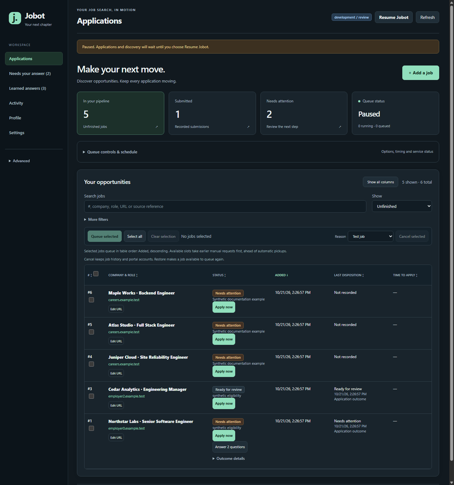
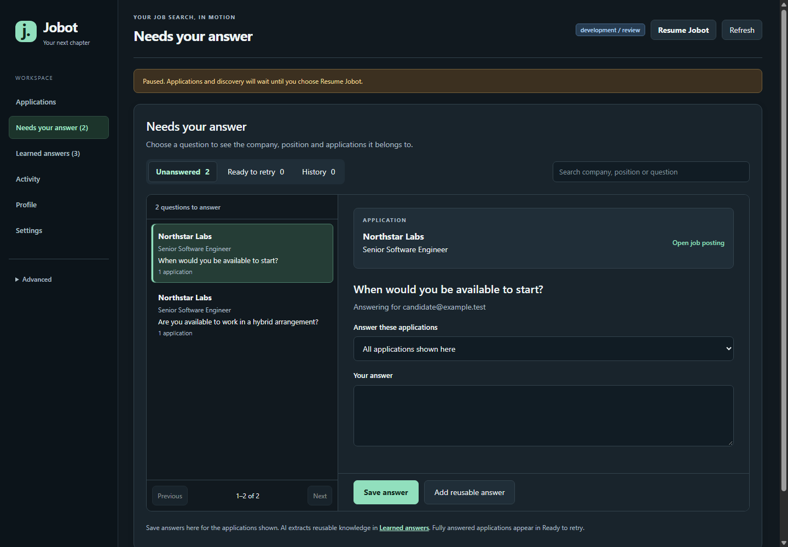
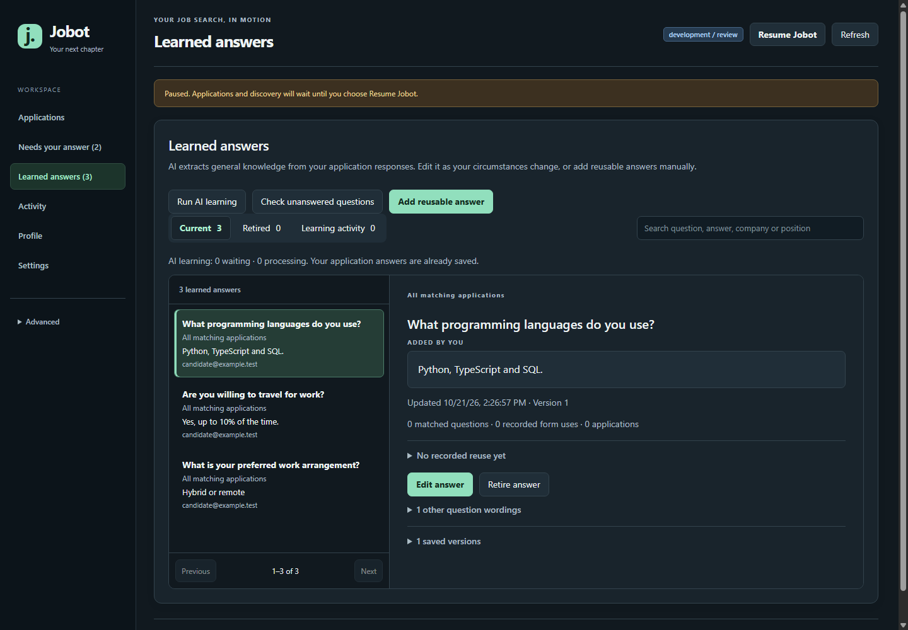
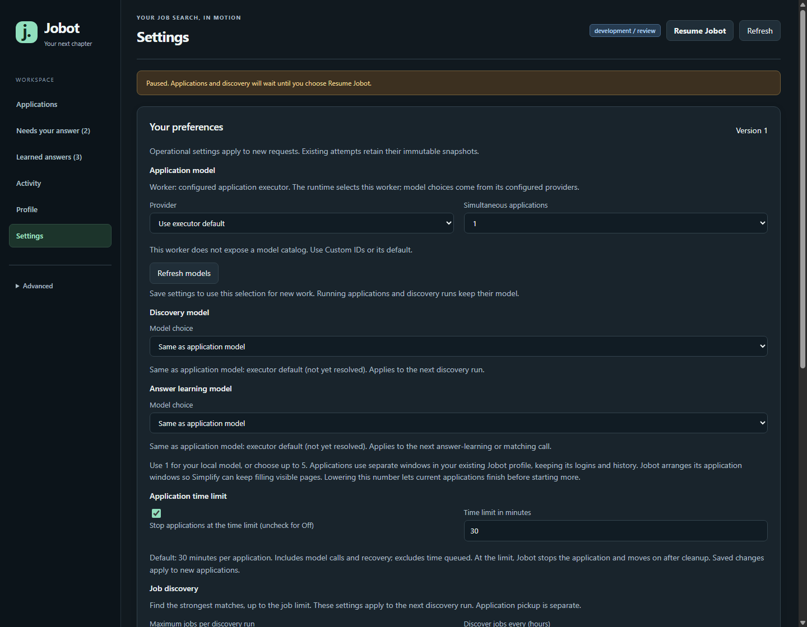
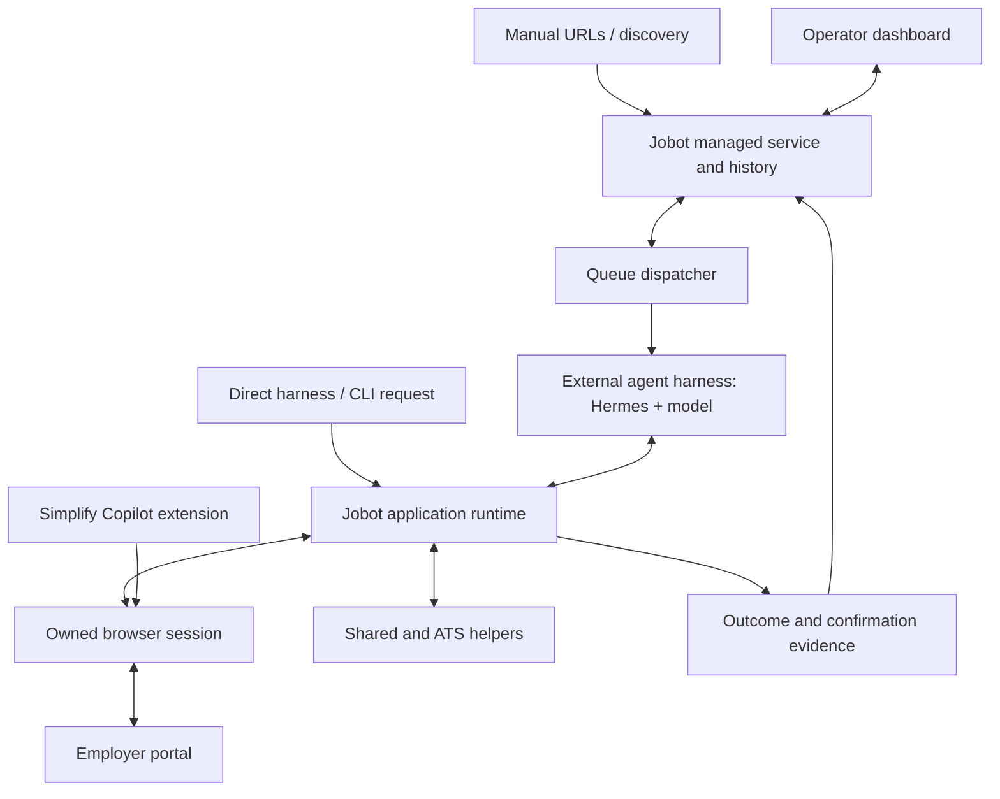

# Jobot

**A local dashboard and application runtime for an agent-assisted job search.**

Jobot brings job discovery, an application queue, human answers and application
history into one workspace. **It depends on an external agent harness and Simplify
Copilot:** Hermes is the documented harness that runs the AI model, reasons through
applications and handles exceptions; the Simplify browser extension fills forms
using your own completed profile. Jobot coordinates their work, owns application
sessions and records outcomes with evidence.

[Get started](docs/GETTING_STARTED.md#first-time-personal-installation) ·
[User guide](docs/USER_GUIDE.md) · [Architecture](docs/ARCHITECTURE.md) ·
[All documentation](docs/README.md)



*Actual dashboard, synthetic demonstration data. All screenshots use fictional
employers and candidate facts; counts and outcomes are illustrations, not performance
results. [Screenshot provenance](docs/images/README.md).*

## What you can do

| Capability | What it gives you |
|---|---|
| **One application pipeline** | Add posting URLs manually or through discovery/integrations. Search, filter, prioritize, cancel and restore jobs while retaining their history. |
| **Managed execution** | Queue selected jobs or use Apply now. Run 1–5 applications with separate executor conversations and owned browser windows. Pause new work or control an individual session. |
| **Human answers when needed** | Fill several questions and save drafts together across matching applications, then queue fully answered applications for retry. Keep original questions and response history. |
| **Reusable knowledge** | See what AI extracted, open its source and inspect recorded application reuse. Maintain versioned answers with global, company or application scope from Learned answers or Profile. |
| **Visible outcomes** | Inspect attempts, progress, timings and confirmation evidence. Activity separates distinct postings, attempts, new submissions and already-applied results. |
| **Your execution settings** | Select model and effort, review-only or submission mode, concurrency and an overall application deadline. Discovery and answer learning can use separate models. |
| **Profiles, resumes and accounts** | Register resume versions, maintain candidate facts and track portal accounts, including private per-account password overrides. |
| **Discovery and notifications** | Use configured discovery sources, duplicate-posting matching and optional Hermes/Discord submission alerts and daily summaries. |

Shared controls and helpers support Workday, Greenhouse, iCIMS and LinkedIn flows.
Coverage varies by employer and form; a helper's presence is not a guarantee of
successful submission. A Submit click or executor exit code alone is not evidence
that an employer accepted the application.

## A look inside

### Resolve missing answers

The answer inbox keeps the employer, role and exact question together. Save the
facts an application needs in the default bulk view with **Save drafts**, or individually,
review answer history and retry when its required answers are ready.



### Keep reusable answers under your control

Inspect, edit or retire learned answers without losing earlier versions. Choose
where an answer applies instead of assuming one employer's response fits every job.
Learning activity connects successful extraction to the saved answer. The overview
shows distinct applications with recorded reuse, with matching and form evidence
kept separate from submission outcomes.



<details>
<summary><strong>See execution and model settings</strong></summary>

Select the application model, optional separate discovery and answer-learning
models, simultaneous applications and time limit. Changes apply to new work.



</details>

## What you need

Jobot is a self-hosted integration. Cloning this repository installs neither an
agent harness nor an authenticated model, mailbox or Simplify account.

| Dependency | Role and setup |
|---|---|
| **Windows or Ubuntu, Python 3.11 and a Chromium browser** | Run Jobot locally with its pinned dependencies and a configured browser profile. The documented desktop setup needs a graphical session. |
| **Agent harness: Hermes + authenticated model provider** | Run the model conversation with terminal, file/skill and screenshot/vision access. Hermes is the documented integration; another compatible harness can use the same local CLI and canonical skills. |
| **Simplify Copilot extension + your Simplify account** | Install in the browser profile Jobot uses, sign in and complete your profile, including education and work history. Simplify performs broad form filling; the harness handles exceptions. |
| **Your candidate profile and resume** | Supply your own facts and approved files in private storage. Jobot does not ship a candidate identity or resume. |
| **Authenticated application mailbox** | Enable employer verification through Hermes's Himalaya or supported Google Workspace integration. Configure access for the mailbox you actually apply with. |
| **Optional Discord and native Hermes plugin** | Add bot conversations or notifications. The portable skill/CLI route works without the native jobbot plugin. |
| **Optional LM Studio embedding endpoint** | Enable semantic company/title matching for duplicate postings when configured. |

Model-provider access and third-party accounts are configured separately. See
[installation](docs/GETTING_STARTED.md#first-time-personal-installation) for setup
and upstream links, and [integrations](docs/INTEGRATIONS.md) for the boundaries.

## How it fits together



Jobot owns records, scheduling, browser targets, lifecycle and reporting. The
external harness reasons about the application, uses Simplify and calls helpers
through the runtime. Helpers assist that executor; their call budgets and recovery
handoffs do not decide when an application is over.

The dashboard and queue worker are separate processes. Closing the dashboard
does not stop the worker, and a reachable dashboard does not prove the worker is
online. Direct local application execution uses the same runtime and history
without requiring a running dashboard or HTTP API token.

The operator's overall application deadline defaults to **30 minutes**, can be
changed or turned **Off**, and applies to new attempts. Browser recovery does not
restart that clock. See [architecture](docs/ARCHITECTURE.md) for the detailed
execution sequence and data ownership.

## Set up Jobot for yourself

The repository is public. Start from `main`:

```text
git clone https://github.com/rejozmathew/Jobot.git Jobot
cd Jobot
```

Follow the [first-time installation guide](docs/GETTING_STARTED.md#first-time-personal-installation)
to install the Python environment, connect Hermes and your model provider,
create private configuration from [profile.json.template](profile.json.template),
register your resume, prepare Simplify and authenticate mail access. It includes
Windows and Ubuntu commands and optional Discord setup.

Choose your submission settings before starting the queue. **Review only**
records readiness for review; **Submit when complete** permits submission within
the configured workflow. The canonical [job-apply procedure](skills/productivity/job-apply/SKILL.md)
and [Workday procedure](skills/productivity/workday-simplify/SKILL.md) are included
in this repository.

### Run an existing installation

With the local private runtime pointer already installed, use the repository's
virtual environment:

```powershell
.\.venv\Scripts\python.exe -m job_applier.queue_runtime status
.\.venv\Scripts\python.exe -m job_applier.queue_runtime serve
```

On Ubuntu, use `./.venv/bin/python` and inspect the installed services rather than
starting a second dispatcher. The dashboard address comes from the selected
configuration's `base_url` (example/default port: 60158). `queue_runtime watch`
is the separate worker entry point. See [Operations](docs/OPERATIONS.md).

Private profiles, credentials, databases, browser sessions and application evidence
stay outside Git. The older `python run_applier.py serve` command starts the
[legacy browser-use dashboard](docs/LEGACY.md), commonly on port 8000 with different
history.

## Documentation

| Topic | Guide |
|---|---|
| Every dashboard page and operator action | [User guide](docs/USER_GUIDE.md) |
| Components, processes and execution flow | [Architecture](docs/ARCHITECTURE.md) |
| Setup and runtime selection | [Getting started](docs/GETTING_STARTED.md), [Configuration](docs/CONFIGURATION.md) |
| Jobs, attempts, answers and evidence | [Data model](docs/DATA_MODEL.md) |
| Hermes, Simplify, discovery, mail and APIs | [Integrations](docs/INTEGRATIONS.md) |
| Services, troubleshooting, deployment and rollback | [Operations](docs/OPERATIONS.md) |
| Implemented milestones and detailed records | [Project history](docs/PROJECT_HISTORY.md), [Engineering index](docs/jobbot-v1/README.md) |
| Development and keeping docs current | [Contributing](CONTRIBUTING.md), [Documentation maintenance](docs/DOCUMENTATION.md) |

## Repository map

| Path | Purpose |
|---|---|
| `job_applier/` | Managed service, runtime, queue, browser ownership, helpers and retained legacy modules |
| `job_applier/static/` | Dashboard HTML, JavaScript and CSS; no frontend build step |
| `skills/productivity/` | Canonical application procedures shared across harnesses |
| `skills/job-posting-harvest/` | Discovery procedure and intake utilities |
| `integrations/` | Hermes plugin and existing JobNavigator bridge maintenance |
| `deploy/` | Sanitized runtime example and systemd templates |
| `tests/jobbot_v1/` | Maintained synthetic managed-runtime and browser/UI regressions |
| `docs/` | Current guides, public demo screenshots and historical engineering records |
| `artifacts/` | Ignored private runtime/validation artifacts; never a public data bundle |

## Development

Read [AGENTS.md](AGENTS.md) and [CONTRIBUTING.md](CONTRIBUTING.md). Use synthetic
fixtures and the repository virtual environment. The standard managed suite is:

```powershell
.\.venv\Scripts\python.exe -m pytest tests/jobbot_v1 -q
```

Follow the repository's delegated validation, local checkpoint and authoritative
Ubuntu deployment workflow. Update the affected docs in the same change using
[the maintenance map](docs/DOCUMENTATION.md).

Jobot grew out of a browser-use application and was previously named Auto Job
Applier / JobBot. Existing `jobbot`, `job_applier`, `JOBBOT_CONFIG`, service names
and `docs/jobbot-v1/` paths remain compatible. Existing installations can keep
their checkout directory.

Numbered [self-improvement records](docs/jobbot-v1/SELF_IMPROVEMENT.md) document
bounded fixes and validation; private application reviews and temporary evidence
remain in ignored storage.
