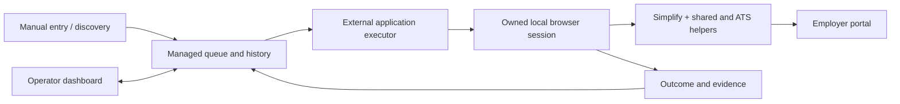

# Auto Job Applier

**JobBot Application Operations** coordinates job discovery, an application queue,
external AI executors, Simplify-assisted browser sessions and evidence-backed
application history. It runs locally with an existing Windows or Ubuntu setup and
provides a dashboard for operating and reviewing the workflow.

Start with the [documentation index](docs/README.md),
[dashboard user guide](docs/USER_GUIDE.md) or [architecture](docs/ARCHITECTURE.md).
These guides describe the managed runtime through October 4, 2026.

## What it does

- Brings manual URLs and discovery/integration sources into one durable job history.
- Queues selected jobs in order, supports per-job Apply now, scheduled retries,
  cancellation/restoration and persistent Pause/Resume JobBot.
- Runs 1–5 queued applications with separate executor conversations and owned
  application windows, using the operator's selected model and deadline.
- Uses Simplify for broad filling, shared browser controls and Workday, Greenhouse,
  iCIMS and LinkedIn helpers, with executor recovery for exceptions.
- Collects unresolved questions, saves human responses and maintains editable,
  versioned learned answers with source history.
- Tracks candidate profiles, resume versions, portal account state, application
  progress, timings and confirmation evidence.
- Reports distinct postings, attempts, new submissions and already-applied results;
  optionally sends confirmed-submission alerts through the existing Hermes setup.

An ATS helper is not a guarantee that every employer form works. Recorded evidence
establishes an outcome; a Submit click or executor exit code alone does not.

## How it fits together



JobBot owns the records, scheduling, browser targets, lifecycle and reports. The
external executor reasons about the application. Helpers assist it; their call
budgets and recovery handoffs do not decide when an application is over. The
operator's overall time limit defaults to 30 minutes and can be changed or turned off.

## Run an existing installation

Use this repository's virtual environment and the existing private runtime
configuration. With the local runtime pointer already installed:

```powershell
.\.venv\Scripts\python.exe -m job_applier.queue_runtime status
.\.venv\Scripts\python.exe -m job_applier.queue_runtime serve
```

On Ubuntu, use `./.venv/bin/python` and the installed services; inspect their state
instead of starting a second dispatcher. The dashboard URL comes from the selected
config's `base_url` (example/default port: 60158).

The dashboard and queue worker are independent. `queue_runtime watch` is the
worker entry point; a working dashboard alone does not mean a worker is online.
Local application execution uses `application_runtime start` or the Hermes
`jobbot` tool and does not require a dashboard or HTTP API token.

For a fresh development checkout, synthetic setup and provisioning requirements,
read [Getting started](docs/GETTING_STARTED.md). Private candidate records,
credentials, browser profiles, authenticated providers and deployment launchers
are not included in Git.

`python run_applier.py serve` starts the **legacy** browser-use dashboard, commonly
on port 8000 with different history. See [Legacy application](docs/LEGACY.md) if you
intend to work on that path.

## Documentation

| Topic | Guide |
|---|---|
| Every dashboard page and operator action | [User guide](docs/USER_GUIDE.md) |
| Components, processes and execution flow | [Architecture](docs/ARCHITECTURE.md) |
| Setup and runtime selection | [Getting started](docs/GETTING_STARTED.md), [Configuration](docs/CONFIGURATION.md) |
| Jobs, attempts, answers and evidence | [Data model](docs/DATA_MODEL.md) |
| Hermes, Simplify, discovery, mail and APIs | [Integrations](docs/INTEGRATIONS.md) |
| Services, troubleshooting, deployment and rollback | [Operations](docs/OPERATIONS.md) |
| Implemented milestones and detailed records | [Project history](docs/PROJECT_HISTORY.md), [Engineering index](docs/jobbot-v1/README.md) |
| Development and keeping docs current | [Contributing](CONTRIBUTING.md), [Documentation maintenance](docs/DOCUMENTATION.md) |

## Repository map

| Path | Purpose |
|---|---|
| `job_applier/` | Managed service, runtime, queue, browser ownership, helpers and retained legacy modules |
| `job_applier/static/` | Dashboard HTML, JavaScript and CSS; no frontend build step |
| `skills/productivity/` | Canonical application procedures shared across harnesses |
| `skills/job-posting-harvest/` | Discovery procedure and intake utilities |
| `integrations/` | Hermes plugin and existing JobNavigator bridge maintenance |
| `deploy/` | Sanitized runtime example and systemd templates |
| `tests/jobbot_v1/` | Maintained synthetic managed-runtime and browser/UI regressions |
| `docs/` | Current guides, detailed engineering references and historical evidence |
| `artifacts/` | Ignored private runtime/validation artifacts; never a public data bundle |

## Development

Read [AGENTS.md](AGENTS.md) and [CONTRIBUTING.md](CONTRIBUTING.md). Use synthetic
fixtures and the repository virtual environment. The standard managed suite is:

```powershell
.\.venv\Scripts\python.exe -m pytest tests/jobbot_v1 -q
```

Follow the repository's delegated validation, local checkpoint and authoritative
Ubuntu deployment workflow. Update the affected docs in the same change using
[the maintenance map](docs/DOCUMENTATION.md).

The project builds on browser-use and integrates an external executor and the
Simplify browser extension.
