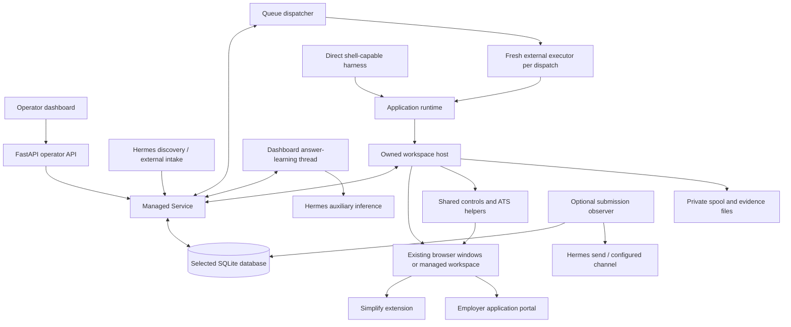
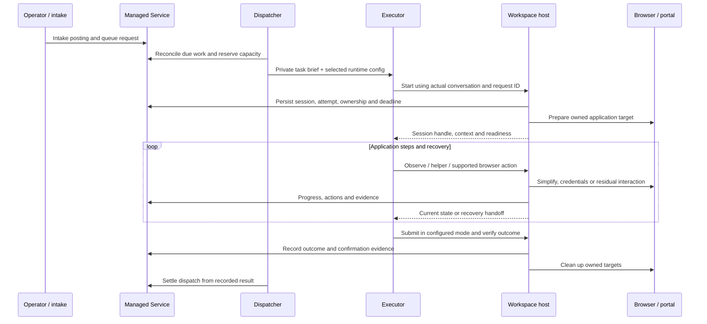

# Architecture

October 8 addition: company/title duplicate matching supplements posting URL
identity. The dashboard refreshes optional LM Studio embeddings outside database
transactions; configured intake refreshes the incoming company's cache. Shared
admission checks use current metadata, corroborating posting facts and the
candidate's recorded success or explicit operator cancellation, including
"no longer interested." Pair decisions remain separate from browser-scope
aliases and never suppress a retry merely because it failed. The existing notification process
also supports a numerical summary of the previous calendar day. See
[matching](jobbot-v1/CROSS_SOURCE_IDENTITY.md) and
[daily reporting](jobbot-v1/SUBMISSION_ALERTS.md#daily-numerical-summary).

[Documentation index](README.md) · [Data model](DATA_MODEL.md) · [Runtime reference](jobbot-v1/APPLICATION_RUNTIME.md)

Reviewed: October 4, 2026. This describes the current managed local-session
runtime. The original browser-use execution path is documented separately in
[Legacy application](LEGACY.md).

## System purpose and boundaries

JobBot coordinates a candidate's job applications. It accepts postings from
manual entry and discovery tools, preserves their identity and history, queues
work, gives an external reasoning executor an owned browser session, and records
the outcome with evidence. The dashboard is the operator's view of that state.

JobBot owns scheduling, records, selected candidate/assets, browser ownership,
deadlines, controls and reporting. The executor reasons about the application
and handles exceptions. Simplify performs broad form filling. Repository helpers
accelerate supported interactions and return evidence to the executor; a helper
failure does not decide the final application outcome.

## Component view

Arrows show calls or data flow, not separate databases. Local clients and the
HTTP API reach the same `Service` and selected managed instance.

## Processes and ownership

| Component | Entry point / source | Responsibility |
|---|---|---|
| Dashboard server | `queue_runtime serve`, `managed_api.py`, `managed_ui.py` | Serve the UI and operator API; start answer learning |
| Browser UI | `static/jobbot.html`, `jobbot.js`, `jobbot.css` | Nine tab views, operator commands and projections; no frontend build tool |
| Managed service | `managed.py` and `managed_*` mixins | Database operations, identity, state transitions, snapshots and evidence |
| Dispatcher | `queue_runtime watch`, `managed_queue.py` | Admit ready requests, reserve capacity, launch and supervise executors, settle results |
| Local application interface | `application_runtime.py` | Resolve configuration, identify the request/driver, prepare and control a session |
| Workspace host | `workspace_host.py`, `workspace_process.py` | Own browser targets and executor-facing operations; enforce lifecycle and cleanup |
| Browser transport | `cdp_client.py`, `browser_frames.py`, `workspace_attachment.py`, `workspace_linux.py` | Chromium DevTools Protocol (CDP), frame routing, trusted input, retained browser attachment |
| External executor | `hermes_desktop.py` or configured Hermes CLI | Model conversation, application decisions and exception handling |
| Discovery | `harvest_runtime.py`, `managed_discovery.py` | Separate discovery runs and provenance-aware intake |
| Answer learning | `answer_learning.py`, `answer_learning_model.py` | Generalize saved responses and review equivalent wording outside application execution |
| Submission alerts | `hermes_notifications.py` | Read confirmed submissions and maintain private delivery receipts |

The dashboard and dispatcher are independent. A working dashboard does not prove
that applications are being dispatched. Local `start` needs neither a running
dashboard nor HTTP API credentials. It does need the selected private config,
managed instance, candidate, resume and browser workspace.

For the Hermes desktop transport, the dispatcher verifies the native backend and
an available configured retained-browser connection before reserving a ready
queue item. A dependency still starting leaves the request queued, with a visible
worker heartbeat, unchanged retry lineage and no application deadline yet.
These short read-only probes run outside database transactions; active work is
still supervised first. Other transports and managed browser allocation retain
their existing startup path. On Ubuntu, the browser service runs a persistent
supervisor at graphical login. It checks the retained profile every five seconds
and relaunches a closed browser, independently of dashboard visits. Queue
readiness still checks the actual browser endpoint before admitting work.

## One queued application

1. Intake canonicalizes the posting and retains source records. Verified posting
   aliases connect different URLs without rewriting old attempts.
2. The queue reconciles eligible intake, explicit requests and scheduled retries.
   Each dispatch captures the selected execution configuration.
3. A fresh external conversation gets a private brief for one job. Direct harness
   callers use the same local-session interface without queue dispatch.
4. `start` checks configured history and real browser readiness. The canonical
   application procedure launches with `wait_seconds:0`, then reads ATS detail
   while preparation completes.
5. Simplify fills supported non-authentication form steps. Selected-account
   credentials, shared controls and ATS helpers handle their respective work.
6. An unfamiliar control or helper handoff goes back to executor recovery. Missing
   expected controls trigger actual visual inspection of the owned page, including
   frames and overlays. Recovery remains inside the original application deadline.
7. The outcome follows confirmation evidence, current controls and submission
   mode. A Submit click or executor exit code alone is not a successful application.
8. Cleanup releases only owned application targets. Dispatch capacity becomes
   available after executor and browser cleanup settle.

For the full procedure, use the [canonical skill](../skills/productivity/job-apply/SKILL.md).
This sequence is an architectural explanation, not a second execution checklist.

## Browser modes, concurrency and recovery

An **existing** workspace attaches to the operator's retained debugging-enabled
browser profile. Queued applications open separate owned windows/tabs; logins,
history and Simplify remain in the shared profile. Personal tabs are retained.
Input briefly takes turns in the foreground; reasoning can overlap. Windows are
arranged to keep application documents visible for autofill.

A **managed** workspace has its own configured profile, browser executable and
CDP endpoint. Available configured workspaces limit capacity for this mode.
`application_concurrency` selects 1–5 queued applications, default 1. Reducing
capacity lets admitted work finish. The system does not infer a lower capacity
from the selected model. Sessions still have independent ownership and outcomes.

The workspace host checks target identity, current document/frame references and
writer state. These checks prevent one application's action from being performed
on another target. Observed Apply/authentication redirects can retain a verified
application route; a hostname alone is not sufficient posting identity.

Reload, reconnect and same-dispatch replacement do not reset the overall
deadline. Its default is 30 minutes; the operator can change it or select Off.
Supervision cancels the owned executor and cleans up at expiry, preserving prior
submission evidence and a distinct timeout reason. Helper call slices are
resumable and are not the overall application deadline.

## Persistence and concurrency

The configured SQLite database is authoritative. `Service.read()` opens a
read-only deferred snapshot; `Service.tx()` uses an immediate write transaction.
Transactions remain bounded around database work rather than model/browser waits.
Schema changes are versioned additive migrations. Runtime preparation verifies
instance identity and backs up the database before applying newer migrations.

Queue and host supervision retain ownership across SQLite BUSY/LOCKED conditions.
Pending executor identity writes and launch reservations resume without launching
another executor. Cached deadlines remain enforceable while bookkeeping is busy.
History projections are batched and indexed to reduce contention.

Operator projections and detailed private evidence serve different purposes. Database events
retain milestones, timings and outcome provenance. The private spool contains
briefs, checkpoints, selected uploads, screenshots and richer answer/submission
records. Mutable checkpoints are working state, not complete immutable history.
See [Data model](DATA_MODEL.md).

## UI and API boundary

The frontend uses plain HTML, CSS and JavaScript. The server serves assets directly
from disk. Visible dashboards refresh on a five-second cadence; hidden tabs defer
polling until visible again. Activity details and paginated answer views avoid
loading every historical record into the main jobs view.

The standard HTTP server accepts loopback hosts and same-origin requests. Opening
the local UI issues an HttpOnly operator-session cookie; the user does not paste
a token into the page. Programmatic HTTP callers use explicit operator/worker
credentials and the instance header. Local transport calls the same service
methods in process using OS access and configured ownership. Installed private
access bridges are deployment-specific; the tracked server is not a public API.

## Shared logic and ATS-specific logic

| Layer | Main modules | Scope |
|---|---|---|
| Shared observation/input | `browser_controls.py`, `browser_frames.py`, `browser_helpers/form_controls.js`, `cdp_client.py` | Controls, embedded documents, verification and trusted input |
| Simplify boundary | `simplify_boundary.py`, `browser_helpers/simplify_*` | Autofill order, writer settlement and step receipts across portals |
| Answers and questions | `application_answers.py`, `managed_questions.py`, `managed_answer_library.py` | Approved facts, saved human answers, reusable knowledge and option mapping |
| Accounts/mail/documents | `managed_credentials.py`, `managed_accounts.py`, `hermes_gmail.py`, `managed_documents.py` | Selected account, email verification and registered uploads |
| Submission | `submission.py`, `managed_shared.py`, `browser_helpers/submission_observe.js` | Explicit submission calls and accepted outcome evidence |
| Workday | `workday_fast.py`, `workday_auth.py`, `browser_helpers/workday_*` | Workday steps, source menus, authentication and advancement |
| Greenhouse | `greenhouse_fast.py` | Scoped residual batches and Greenhouse recovery |
| iCIMS | `icims_fast.py`, `form_audit.py` | Apply handoff, post-autofill audit and delayed step transitions |
| LinkedIn | `linkedin_easy_apply.py`, `browser_helpers/linkedin_observe.js` | Easy Apply flow and observed external handoffs |

The complete helper/caller map remains in the [runtime reference](jobbot-v1/APPLICATION_RUNTIME.md).
Older callers under `platform_handlers/` still use shared components. Adding a
new fast path does not establish that those callers can be removed.

## Design decisions and practical limits

- A replaceable executor keeps provider/model choices outside durable application
  records and lifecycle ownership.
- Local sessions make a dashboard and HTTP worker lease optional for execution.
- Explicit candidate, account, posting and target identities avoid selecting
  private data or browser state by accident.
- Evidence distinguishes new submission, already-applied and uncertainty. Historical
  success is preserved when later recovery or cleanup fails.
- Human answers and learned knowledge are versioned separately; model synthesis
  cannot replace concurrent operator edits or turn an old response into a new fact.
- Review mode, selected submission mode, retry scheduling and operator deadlines
  are existing product behavior, not helper-defined stop decisions.

Synthetic tests establish particular mechanisms. They do not establish universal
ATS support, headless Simplify compatibility, production throughput or a submission
rate. The repository is an operated application with private provisioning; it does
not contain a one-command public production bootstrap or a multi-user hosted service.
