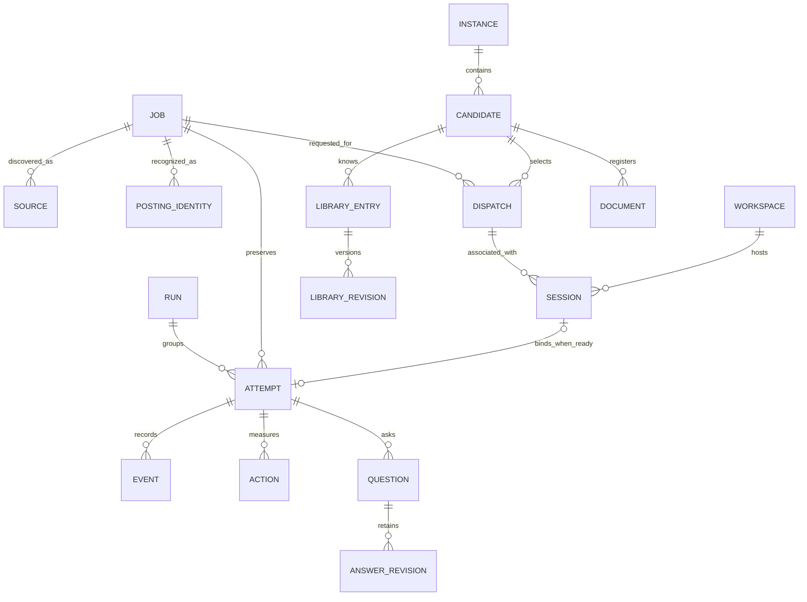

# Data model and evidence

[Documentation index](README.md) · [Architecture](ARCHITECTURE.md)

## The units of work

| Term | Meaning |
|---|---|
| Instance | One explicitly selected managed SQLite database and its settings |
| Candidate | A person identity with factual profile data and registered assets |
| Job / posting | A durable employer opportunity; may have several observed URLs and sources |
| Dispatch | A queued request to launch an external executor for a job |
| Session | The local runtime handle binding request, conversation, candidate and workspace |
| Run | Managed protocol grouping and control/snapshot record; retained for local and legacy worker paths |
| Attempt | One execution of an application; earlier attempts remain after retries |
| Workspace | Configured browser profile/endpoint owned by a workspace host |
| Target | An owned application tab or associated browser target |
| Outcome | Recorded attempt result; different from queue scheduling or job disposition |

One posting can have many attempts. A dispatch can retain replacement sessions
from its native conversation. A new session is not necessarily a new job, and a
finished executor process is not necessarily an accepted application.

This is a conceptual relationship diagram, not generated SQL. In particular,
dispatch/session association also uses request and driver identity rather than a
single universal foreign key. Actual definitions live in
[`database.py`](../job_applier/database.py) and
[`managed_migrations.py`](../job_applier/managed_migrations.py).

## Storage map

| Area | Principal tables | Owning modules |
|---|---|---|
| Instance and settings | `instance`, `settings_revisions`, `schema_migrations` | `managed.py`, `managed_settings.py`, `managed_migrations.py` |
| Postings and provenance | `jobs`, `job_sources`, `source_observations`, `job_identity_keys` | `managed.py`, `managed_identity.py`, `managed_discovery.py` |
| Candidate and account | `candidates`, `company_portal_accounts`, `account_requests`, `account_namespace_aliases`, `account_coordination` | `managed_accounts.py`, `managed_credentials.py` |
| Queue/discovery | `dispatch_queue`, `dispatch_control`, `dispatch_immediate_requests`, `discovery_runs`, `discovery_control` | `managed_queue.py`, `managed_discovery.py` |
| Semantic posting matches | `job_embedding_cache`, `job_duplicate_model`, `job_duplicate_matches`, `job_duplicate_skips` | `job_duplicates.py`; migration 29 preserves original jobs and outcomes |
| Runs and local sessions | `runs`, `run_jobs`, `application_attempts`, `application_sessions`, `browser_workspaces`, `run_sessions`, `run_checkpoints` | `managed.py`, `managed_sessions.py`, `managed_continuity.py` |
| Browser ownership | `owned_targets`, `target_history`, `workspace_profile_aliases`, legacy `browser_leases` | `managed_runtime.py`, `managed_sessions.py` |
| Execution evidence | `managed_events`, `managed_actions`, `submission_ledger` | `managed_events.py`, `managed_reports.py`, `managed_shared.py` |
| Human answers | `application_questions`, `application_question_answers`, `answer_retry_requests` | `managed_questions.py` |
| Reusable knowledge | `answer_library_entries`, `answer_library_versions`, `answer_learning_sources`, `answer_learning_reviews` | `managed_answer_library.py`, `answer_learning.py` |
| Documents | `document_assets`, `document_selections`, `document_uploads`, `match_assessments` | `managed_documents.py` |
| Procedural learning | `lessons`, `lesson_history`, `helper_versions`, `helper_history` | `managed_learning.py` |
| Mail and archival | `mail_requests`, `attempt_mail_requests`, `job_archives` | `managed_accounts.py`, `managed_archive.py` |

Schema version 29 is the reviewed baseline. Do not hard-code it as an installation's
current version; inspect service health and the migration list.

## Posting and account identity are different

Intake uses canonical URLs, ATS requisition keys and observed evidence to connect
the same posting across sources. It retains original source URLs, external source
IDs and discovery provenance. An observed application URL can become a verified
alias without replacing the original job or its attempt history.

Account namespaces select the candidate's employer/portal account. A posting site
identifier is not always a valid account namespace; account context can fall back
to the existing account URL. A display company name or shared ATS hostname is not
enough to establish every identity relationship.

See [Cross-source identity](jobbot-v1/CROSS_SOURCE_IDENTITY.md) and
[Source/process attribution](jobbot-v1/SOURCE_PROCESS_ATTRIBUTION.md).

## Outcomes, disposition and retry scheduling

| Record | Examples | Interpretation |
|---|---|---|
| Attempt outcome | `applied`, `already_applied`, `ready_for_review`, `blocked`, `failed`, `interrupted`, `submission_unknown` | What the attempt actually established |
| Job disposition | Active or operator-canceled | Whether the operator wants the posting available for work |
| Queue state | `queued`, `dispatched`, `finished` | Scheduling/executor state, not proof of submission |
| Timeout reason | `application_time_limit` | Distinct expiry diagnosis; does not require a new success/failure label |

Successful submission is durable evidence. An ambiguous click remains uncertain.
An already-applied result is distinct from a new submission. A timeout, stop or
cleanup failure must not downgrade prior accepted evidence.

Automatic scheduling currently allows six attempts in a series with spaced due
times. An explicit later retry can start a fresh series. Those scheduling rules do
not stop recovery within the active attempt and do not establish a permanent
job-wide retry ban. See [Retry policy](jobbot-v1/RETRY_POLICY.md).

## Answers: response history versus current knowledge

The dashboard projects reuse evidence from existing `application_question_answers`
and the configured private spool's per-attempt answer journals. Distinct questions
resolved by the library and recorded form uses are separate counts. Journals must
match the authoritative attempt, candidate and job and name a library ID/revision.
Recent evidence retains the version actually used; edits do not rewrite it. These
counts do not imply submission or capture unrecorded model reasoning. No new table
or duplicated answer store is introduced. `{company}` in question wording binds
to the posting's company; existing scope precedence handles exceptions.

Human responses belong first to the actual application questions. Revisions retain
the original wording, choices and answer provenance. A candidate-scoped library
stores current reusable knowledge separately, with global, company or job scope
and optional country, currency and pay-period qualifiers.

AI synthesis runs outside the application executor. It can generalize grounded
responses and suggest equivalent wording; it preserves sources and surfaces
conflicts. Explicit human answers remain application overrides. Editing or retiring
knowledge changes current reuse while keeping earlier versions. Existing completed
response snapshots are not rewritten by reconciliation.

Profile facts remain a separate source rather than being copied into permanent
library entries. A missing library match returns control to ordinary interpretation,
available facts and recovery; it does not define an application failure.

## Evidence and private files

Database projections contain sanitized timeline and outcome information. Private
spool records retain richer application context, answer journals, browser captures,
dispatch tasks, model receipts and checkpoints. Profile/credential references and
selected document bytes also remain private.

Submission verification records its actual source: employer/native confirmation,
accepted Simplify confirmation, or an explicit user-reported reconciliation where
applicable. A `submission_ledger` entry and its associated attempt evidence matter;
a process exit code or screenshot filename alone is insufficient.

Failure projections prefer specific completed-attempt evidence over helper errors.
An explicit outcome observed at or after completion can refine that projection;
generic worker cleanup still falls back to diagnostic events. This changes the
displayed reason, not the recorded outcome, completion time or event history.

Activity aggregates attempts by their start-date cohort in the selected timezone.
It distinguishes raw attempts, deduplicated postings, new submissions,
already-applied results and dispatch counts. See [Activity statistics](jobbot-v1/ACTIVITY_STATS.md).

## Changes, backups and retention

Use service operations for normal mutations. Preserve earlier attempts, source
records, account state, answer revisions and selected-asset evidence. Canceling a
job is reversible and preserves history; archive/export operations have their own
preview and backup contracts.

`prepare_local()` uses an instance-verified SQLite backup before newer additive
migrations. Use the SQLite backup API or managed backup tools for a live database;
copying just the main database file can omit active WAL contents. Restoring an old
database as part of a code rollback would discard newer application history.

Disposable synthetic fixture directories have separate completion manifests and
retention. They are not application evidence. See
[Validation storage](jobbot-v1/VALIDATION_STORAGE.md).
